# AI avatar video pipeline

Turns a topic into a finished talking-avatar video ad: an AI copywriter writes the script, a second agent critiques and rewrites it, OpenAI voices it, VEED animates the avatar, and the result is emailed and logged.

Built for a client project (an AI video pipeline delivered with Brody Automates). This is the working version.

**Nodes:** 16 · **Uses:** n8n Form, AI Agent, OpenAI, Uploadcare, VEED, Gmail, Google Sheets

## Flow

```mermaid
flowchart LR
    n0(["Enter Video Topic"])
    n1["Generate Ad Script"]
    n2["OpenAI Chat Model1"]
    n3["Self-Critique & Rewrite Script"]
    n4["OpenAI Chat Model"]
    n5["Generate audio"]
    n6["Upload Audio to Cloud (Uploadcare)"]
    n7["Download Image"]
    n8["Upload Image to Uploadcare"]
    n9["Set Avatar Image + Audio URL"]
    n10["Generate Talking Video (VEED Fabric 1.0)"]
    n11["Wait for Video to Render"]
    n12["Video URL Valid?"]
    n13["Email: Video Ready"]
    n14["Email: Generation Failed"]
    n15["Log to Google Sheets"]
    n0 --> n1
    n2 -.-> n1
    n1 --> n3
    n4 -.-> n3
    n3 --> n5
    n5 --> n6
    n6 --> n7
    n7 --> n8
    n8 --> n9
    n9 --> n10
    n10 --> n11
    n11 --> n12
    n12 --> n13
    n12 --> n14
    n13 --> n15
```

Dotted lines are AI sub-nodes (model, memory, tools) plugged into an agent.

## How it works

1. A form takes the topic and an avatar image URL.
2. Agent 1 writes a short Instagram Reels ad script; agent 2 reviews it as a creative director and rewrites it.
3. OpenAI text-to-speech generates the voiceover; audio and image are uploaded to Uploadcare to get public URLs.
4. VEED Fabric 1.0 generates the talking video; the workflow waits for the render.
5. If the video URL is valid, the video is emailed and logged to Google Sheets; otherwise a failure email goes out.

## Setup

1. In n8n: **Workflows > Import from file** and pick [`workflow.json`](workflow.json).
2. Connect your own credentials (none are included):
- OpenAI credential (chat + audio)
- VEED credential
- Uploadcare public key (replace `YOUR_UPLOADCARE_PUBLIC_KEY`)
- Gmail and Google Sheets credentials, and your sheet ID
3. Replace every `YOUR_...` placeholder, run it once by hand, then activate it.
