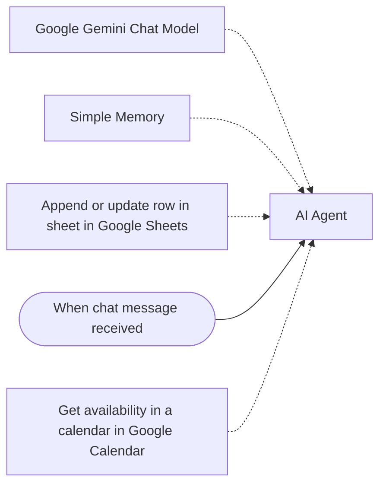

# Clinic booking chat agent

A chat agent that books dental appointments: it collects the patient's details step by step, checks real availability in Google Calendar, confirms the slot and saves the booking to Google Sheets.

Built as a demo for clinics; Gemini as the model, with conversation memory.

**Nodes:** 6 · **Uses:** AI Agent, Gemini, Memory, Google Sheets, Chat, Google Calendar

## Flow

Dotted lines are AI sub-nodes (model, memory, tools) plugged into an agent.

## How it works

1. A chat trigger receives the patient's message.
2. The agent (Gemini, with a short memory window) asks one question at a time: name, phone, email, service, preferred time.
3. It calls a Google Calendar tool to check availability.
4. It writes the confirmed booking to Google Sheets and summarizes it for the patient.

## Setup

1. In n8n: **Workflows > Import from file** and pick [`workflow.json`](workflow.json).
2. Connect your own credentials (none are included):
- Google Gemini credential
- Google Calendar and Google Sheets credentials, your calendar and sheet IDs
3. Replace every `YOUR_...` placeholder, run it once by hand, then activate it.
