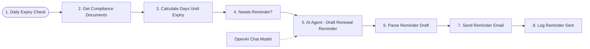

# Compliance document expiry tracker

Checks a register of licences, certificates and contracts every morning, and has an AI agent draft a renewal reminder for anything close to or past its expiry date.

Part of my daily automation series.

**Nodes:** 9 · **Uses:** Schedule, Google Sheets, AI Agent, Gmail, OpenAI

## Flow

Dotted lines are AI sub-nodes (model, memory, tools) plugged into an agent.

## How it works

1. Runs every day at 8:00 and reads the document register from Google Sheets.
2. Calculates days until expiry for each document.
3. For documents that need a reminder, an AI agent drafts a renewal email with the right urgency.
4. The reminder is sent by Gmail and logged back to the sheet.

## Setup

1. In n8n: **Workflows > Import from file** and pick [`workflow.json`](workflow.json).
2. Connect your own credentials (none are included):
- OpenAI credential
- Gmail and Google Sheets credentials, and your sheet ID
3. Replace every `YOUR_...` placeholder, run it once by hand, then activate it.
