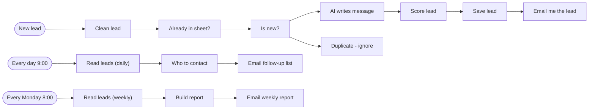

# Lead capture and follow-up machine

The lead system behind Tbibia, my dental clinic software: every new lead is cleaned, deduplicated, scored and given an AI-written first message, then daily and weekly jobs make sure nobody is forgotten.

Built for my own product, Tbibia (tbibia.com).

**Nodes:** 17 · **Uses:** Webhook, Code (JavaScript), Google Sheets, Claude API, Gmail, Schedule

## Flow

Dotted lines are AI sub-nodes (model, memory, tools) plugged into an agent.

## How it works

1. A webhook receives a lead from the site (name, phone, clinic, city, source, message).
2. A Code node normalizes the phone number (Tunisian format) and drops invalid leads.
3. Google Sheets is checked for duplicates.
4. Claude writes a personal first WhatsApp message in French; if the AI call fails, a template is used instead.
5. The lead is scored, saved to the sheet and emailed to me.
6. Every day at 9:00: leads not contacted after 24h and contacted leads silent for 3+ days (max 2 follow-ups) are emailed as a to-do list.
7. Every Monday at 8:00: a weekly report of the pipeline.

## Setup

1. In n8n: **Workflows > Import from file** and pick [`workflow.json`](workflow.json).
2. Connect your own credentials (none are included):
- Header-auth credential for the Anthropic API (`x-api-key`)
- Gmail and Google Sheets credentials, and your sheet ID
3. Replace every `YOUR_...` placeholder, run it once by hand, then activate it.
