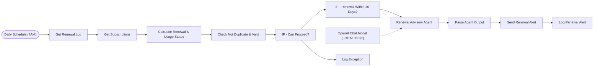

# Subscription and SaaS renewal auditor

Watches every software subscription a team pays for. When one renews within 30 days, an AI agent looks at usage and cost and advises the owner to keep, downgrade or cancel.

Part of my daily automation series.

**Nodes:** 13 · **Uses:** Schedule, Google Sheets, AI Agent, OpenAI, Gmail

## Flow

Dotted lines are AI sub-nodes (model, memory, tools) plugged into an agent.

## How it works

1. Runs every day at 7:00 and reads the subscription list.
2. Calculates days to renewal and usage status.
3. For renewals within 30 days, an AI agent writes a short recommendation.
4. Duplicate and validity checks run before anything is sent; the alert is emailed and logged, exceptions go to their own log.

## Setup

1. In n8n: **Workflows > Import from file** and pick [`workflow.json`](workflow.json).
2. Connect your own credentials (none are included):
- OpenAI credential
- Gmail and Google Sheets credentials, and your sheet IDs
3. Replace every `YOUR_...` placeholder, run it once by hand, then activate it.
