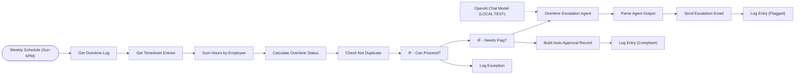

# Timesheet and overtime compliance checker

Every Sunday it totals each employee's hours, auto-approves compliant weeks, and has an AI agent write an escalation email to the manager for overtime, with duplicate protection and an exception log.

Part of my daily automation series.

**Nodes:** 16 · **Uses:** Schedule, Google Sheets, AI Agent, OpenAI, Gmail

## Flow

Dotted lines are AI sub-nodes (model, memory, tools) plugged into an agent.

## How it works

1. Runs weekly (Sunday 18:00) and reads the timesheet entries.
2. Sums hours per employee and calculates the overtime status.
3. Compliant weeks get an auto-approval record in the log.
4. Flagged weeks are checked against the log so the same week is never escalated twice.
5. An AI agent writes the escalation email to the manager; it is sent and logged. Anything that can't proceed goes to an exception log.

## Setup

1. In n8n: **Workflows > Import from file** and pick [`workflow.json`](workflow.json).
2. Connect your own credentials (none are included):
- OpenAI credential
- Gmail and Google Sheets credentials, and your sheet IDs
3. Replace every `YOUR_...` placeholder, run it once by hand, then activate it.
