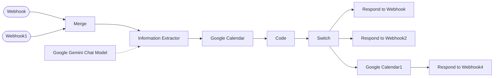

# Voice agent appointment scheduler

The backend tools for an AI phone agent: one webhook checks if a requested time is free, another books it in Google Calendar.

Called as tools by a voice AI agent during a live call.

**Nodes:** 12 · **Uses:** Webhook, Google Calendar, Code (JavaScript), Information Extractor, Gemini

## Flow

Dotted lines are AI sub-nodes (model, memory, tools) plugged into an agent.

## How it works

1. `POST /get_availability`: Gemini's Information Extractor turns the caller's words ("next Tuesday afternoon") into a time.
2. A Code node checks it against business hours and existing Calendar events, and suggests the next free slot if needed.
3. `POST /book_appointment`: a Switch routes the request, the event is created in Google Calendar, and the result goes back to the voice agent.

## Setup

1. In n8n: **Workflows > Import from file** and pick [`workflow.json`](workflow.json).
2. Connect your own credentials (none are included):
- Google Gemini credential
- Google Calendar credential and your calendar ID
- Point your voice agent's tool calls at the two webhook URLs
3. Replace every `YOUR_...` placeholder, run it once by hand, then activate it.
